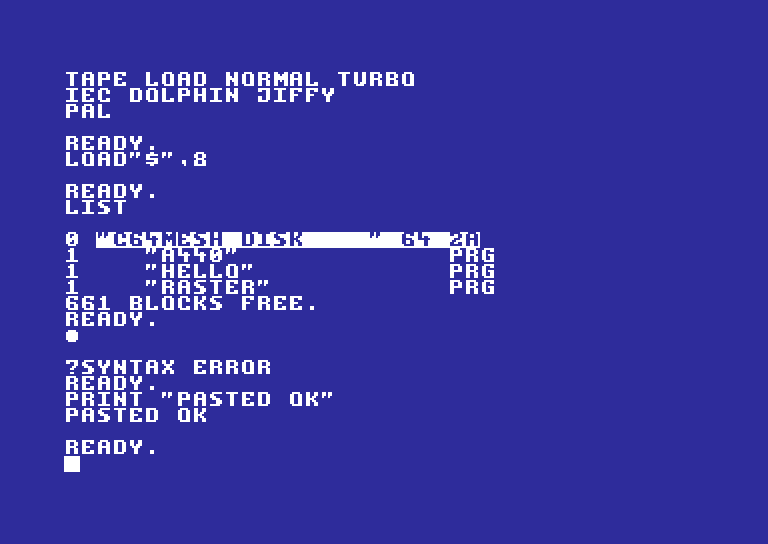

# Heltec-C64

A Commodore 64 running on a **Heltec WiFi LoRa 32 V3** (the Meshtastic board), played in any
**web browser** on your Wi‑Fi, with **SID sound**. Works on a PC, Mac or iPhone; nothing to install.

- 6502 CPU (passes the Klaus Dormann functional test), VIC-II text/bitmap/multicolour modes,
  sprites with collisions, raster interrupts, both CIAs (timers, keyboard, joystick, clock)
- SID sound: 3 voices, triangle/saw/pulse/noise, ring mod and sync, real ADSR timing, filter,
  and the `$D418` volume trick used for sampled speech/drums
- The board serves the C64 as a web page: screen and sound stream over a WebSocket
- Your PC keyboard, plus an on-screen C64 keyboard and touch joystick for phones and tablets
- **Your own ROMs**: upload BASIC / KERNAL / CHARACTER ROM files from the settings page
- **Cartridges** (`.crt`): normal 8K/16K, MAX/Ultimax, Ocean, Magic Desk/Domark, C64 Game System,
  Dinamic, Super Games, Simons' BASIC and EasyFlash, up to 1.1 MB
- **Floppy images** (`.d64`) in drive 8 with their real directory, plus loose `.prg` files:
  `LOAD"$",8`, `LOAD"GAME",8,1`, `SAVE"PROG",8`
- OLED shows the address to open (or a mini view of the C64 screen)




> Flashing this replaces Meshtastic. To go back, reflash Meshtastic from flasher.meshtastic.org.

## 1. Flash it

**Easiest:** open the **[Heltec-C64 Flasher](https://hardwaremack-prog.github.io/Heltec-C64/flasher/)** in
Chrome or Edge on a computer, plug the board in with USB-C, click **INSTALL HELTEC-C64**, pick its
port and click Install. Tick *Erase* the first time; leave it unticked when updating so your ROMs and
disk files are kept. Press the board's RST button when it's done.

**Or with esptool:**
```
esptool --chip esp32s3 write-flash 0x0 firmware/Heltec-C64.bin
```
If the board doesn't show up, hold **PRG**, tap **RST**, release **PRG**, then try again.

Re-flashing an update keeps your uploaded ROMs and disk files (unless you choose Erase).

## 2. Get it on Wi-Fi

First boot, the board makes a hotspot: **C64-Setup**, password **commodore64**.
Join it and open **http://192.168.4.1/settings**, scan/pick your network under *Wi-Fi*, save.
The board reboots onto your network and the OLED shows its address.

## 3. Play

Open **http://\<board-ip\>/** (or **http://c64.local/**) in a browser and tap/click the screen
once; browsers only allow sound after a tap. One viewer at a time; opening it somewhere else
takes over.

Toolbar: 🔊 sound on/off · ⌨ on-screen C64 keyboard · 🎮 touch joystick · Port 1/2 (which
joystick port games read) · 📋 type or paste text · ↻ reset · ⛶ full screen · ⚙ settings.

| PC key | C64 key |
|---|---|
| Esc | RUN/STOP |
| Page Up | RESTORE |
| Tab or Left Ctrl | CTRL |
| Alt / Windows / Cmd | C= (Commodore) |
| Home | CLR/HOME |
| Insert / Delete, Backspace | INST / DEL |
| Arrows | cursor keys |
| F1–F8 | F1–F8 |
| `\` or `£` | £ ; `_` or `` ` `` = ←, `^` = ↑ |
| Numpad 8/2/4/6 (7/9/1/3 diagonals), Numpad 0/5 or Right Ctrl | Joystick |

Typing is symbolic: type `"` and the C64 gets SHIFT+2. Pasting (Ctrl+V / Cmd+V) types the text
into the C64, handy for BASIC listings. No numpad on your laptop? In the 📋 dialog tick
**Arrow keys + Space = joystick**.

On an iPhone the on-screen keyboard opens automatically: SHIFT, C= and CTRL latch until the
next key. Tip: Share → *Add to Home Screen* gives it a full-screen app icon.

## 4. Use your own ROMs

Open **⚙ Settings** → **ROMs**. For each slot pick your file and click **Upload**:

| Slot | Size | Usual chip |
|---|---|---|
| BASIC | 8192 bytes | 901226-01 |
| KERNAL | 8192 bytes | 901227-03 (or -01/-02, JiffyDOS works too) |
| CHARACTER | 4096 bytes | 901225-01 |

A 16 KB BASIC+KERNAL combo file is accepted in either slot and split automatically. Known
Commodore dumps are recognised by checksum. Then set each slot to **My ROM file** and click
**Apply & restart C64**. Switch back to the built-in set any time.

The built-in fallback is the free **Open ROMs** (MEGA65 project, LGPL-3). Its KERNAL boots and
loads programs, but its BASIC is unfinished (no maths: `PRINT 2+2` gives NOT IMPLEMENTED),
so your real ROMs are the full experience.

You can also bake different fallback ROMs into the firmware:
`python3 tools/make_roms.py basic.bin kernal.bin chargen.bin Heltec-C64/builtin_roms.h` and rebuild.

## 5. Cartridges

Settings → **Cartridge** → pick a `.crt` file → **Upload & insert**. The C64 restarts into the
cartridge, and it stays plugged in across power cycles until you click **Eject**. One cartridge is
kept at a time, in its own 1.1 MB flash area, read directly from flash so it doesn't use RAM.

Supported types: normal 8K/16K, MAX machine (Ultimax), Ocean, Magic Desk / Domark / HES Australia,
C64 Game System / System 3, Dinamic, Super Games, Simons' BASIC and EasyFlash. Freezer cartridges
(Action Replay, Final Cartridge and so on) aren't supported; the page tells you the type if a
file can't be used. Raw 8K/16K `.bin` dumps are accepted too.

Some cartridges unpack themselves before showing anything; Bad Lands, for example, shows a grey
screen for about 15 seconds first.

## 6. Floppy disks and programs

**Disk images:** Settings → **Floppy disks** → upload a `.d64` (it goes straight into the drive).
On the C64: `LOAD"$",8` then `LIST` shows the disk's real directory; `LOAD"NAME",8,1` then `RUN`
(or `LOAD"*",8,1` for the first program). Keep as many images as fit (about 25 in the 4.8 MB of
storage) and swap them with **Insert** / **Eject**.

**Program files:** with the drive empty, drive 8 is a folder of loose `.prg` files instead.
Settings → **Program files** → upload a `.prg` (tick *load & run now* to start it straight away).
`SAVE"NAME",8` always saves there, and you can download saved programs from the settings page.

There's no real 1541 drive inside, so loading works through the C64's normal LOAD routine.
Games that load with plain `LOAD` work, including ones that load more parts that way.
Games with their own fast loaders, copy protection, or that read the disk directly won't.

## Board buttons and lights

- **PRG** tap: switch the OLED between status and a mini view of the C64 screen
- **PRG** hold 2 s: reset the C64
- White LED: on while a browser is connected

## Limitations

- Sound plays about 0.1 s behind the picture (network buffering).
- On iPhone, if there's no sound, check the ringer switch and volume.
- No real 1541 drive: fast loaders, copy-protected disks and disk-reading utilities don't work
  (see section 6). No tape, no freezer cartridges.
- PAL only. Not cycle-exact: BASIC and ordinary games run fine; timing-critical demos won't.
- The SID is a compact emulation: it sounds right, but isn't a sample-exact reSID.
- If the ESP32 falls behind, it draws fewer frames to keep the C64 and its sound at full speed.
  The status line shows the frame rate; Settings shows the speed.

## Build from source

Arduino IDE with the **esp32** core 3.x, board **Heltec WiFi LoRa 32(V3)**. Open
`Heltec-C64/Heltec-C64.ino`; `partitions.csv` in the sketch folder sets up a 1.9 MB app, a 1.1 MB
cartridge area and ~4.8 MB of storage. No extra libraries needed.

| File | What it is |
|---|---|
| `c64.*` | CPU, memory map (incl. cartridge port), VIC-II, CIAs, LOAD/SAVE traps |
| `media.*` | `.crt` cartridge parser and `.d64` disk image reader |
| `boardmedia.h` | board storage for cartridges (flash partition) and disk images |
| `sid.*` | SID sound chip |
| `stream.*` | WebSocket server: screen tiles, sound, keys |
| `keymap.*` | PC / on-screen keys to the C64 keyboard matrix and joystick |
| `player.h` | the browser page that is the C64 |
| `webui.h` | settings page (ROMs, cartridge, disks, Wi-Fi) |

`host/` has a PC build of the same emulator and stream code, with tests:
```
cd host
g++ -O2 -std=c++17 -o c64host hostmain.cpp ../Heltec-C64/c64.cpp ../Heltec-C64/sid.cpp ../Heltec-C64/keymap.cpp ../Heltec-C64/stream.cpp ../Heltec-C64/media.cpp -lpthread
./c64host --disk disk                          # stream on ws://localhost:8181
./c64host --cart game.crt                      # with a cartridge plugged in
./c64host --d64 disk.d64                       # with a floppy image in drive 8
python3 test_stream.py video                   # screen, typing, paste
./c64host --frames 400 --sys examples/A440.prg --wav out.wav   # headless run, record the SID to a WAV
```

## Licences

Heltec-C64 code: yours to use. Built-in Open ROMs: © Paul Gardner-Stephen, Roman Standzikowski
and contributors, LGPL-3 (see `roms/LICENSE-OpenROMs-LGPL3.txt`; source at
github.com/MEGA65/open-roms). Commodore ROMs are not included.
