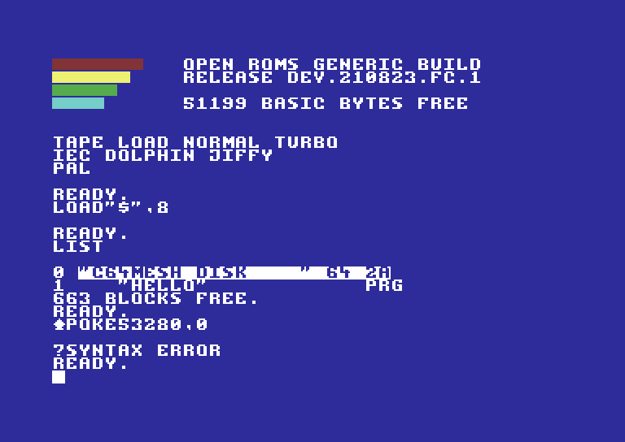
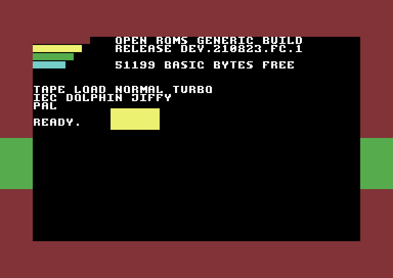

# C64 Mesh

A Commodore 64 running on a **Heltec WiFi LoRa 32 V3** (the Meshtastic board), viewed and
played over **VNC** on Wi-Fi.

- 6502 CPU (passes the Klaus Dormann functional test), VIC-II text/bitmap/multicolour modes,
  sprites with collisions, raster interrupts, both CIAs (timers, keyboard, joystick, clock)
- VNC server on port **5900** (no password; Raw + Hextile, any colour depth)
- Web control page on port **80**: ROMs, virtual disk, typing, reset, Wi-Fi
- **Your own ROMs**: upload BASIC / KERNAL / CHARACTER ROM files from the web page
- Virtual disk on the board's flash: `LOAD"$",8`, `LOAD"GAME",8,1`, `SAVE"PROG",8`
- OLED shows the IP address (or a mini view of the C64 screen)




> Flashing this replaces Meshtastic. To go back, reflash Meshtastic from flasher.meshtastic.org.

## 1. Flash it

**Easiest (Chrome or Edge):** open `https://espressif.github.io/esptool-js/`, plug the board in
with USB-C, click **Connect**, choose its port, set the address to **0x0**, pick
`firmware/C64Mesh-HeltecV3.bin` and click **Program**. Press the RST button when done.

**Or with esptool:**
```
esptool --chip esp32s3 write-flash 0x0 firmware/C64Mesh-HeltecV3.bin
```
If the board doesn't show up, hold **PRG**, tap **RST**, release **PRG**, then try again.

Re-flashing an update keeps your uploaded ROMs and disk files.

## 2. Get it on Wi-Fi

First boot, the board makes a hotspot: **C64-Setup**, password **commodore64**.
Join it, browse to **http://192.168.4.1**, scan/pick your network under *Wi-Fi*, save. The board
reboots onto your network and the OLED shows its IP address. (Also reachable as `c64.local`.)

## 3. Connect with VNC

Point any VNC viewer (RealVNC Viewer, TigerVNC, TightVNC, Remmina) at `<board-ip>:5900`.
No password. In AP mode use `192.168.4.1:5900`. (macOS Screen Sharing insists on a password,
so use one of the others on a Mac.)

| PC key | C64 key |
|---|---|
| Esc | RUN/STOP |
| Page Up | RESTORE |
| Tab or Left Ctrl | CTRL |
| Alt / Windows key | C= (Commodore) |
| Home | CLR/HOME |
| Insert / Delete, Backspace | INST / DEL |
| Arrows | cursor keys |
| F1–F8 | F1–F8 |
| `\` or `£` | £ |  `_` or `` ` `` = ←, `^` = ↑ |
| Numpad 8/2/4/6 (7/9/1/3 diagonals), Numpad 0/5 or Right Ctrl | Joystick in port 2 |

Typing is symbolic: type `"` on your PC and the C64 gets SHIFT+2. Pasting text into the
viewer types it into the C64 (great for BASIC listings).

## 4. Use your own ROMs

Open the web page → **ROMs**. For each slot pick your file and click **Upload**:

| Slot | Size | Usual chip |
|---|---|---|
| BASIC | 8192 bytes | 901226-01 |
| KERNAL | 8192 bytes | 901227-03 (or -01/-02, JiffyDOS works too) |
| CHARACTER | 4096 bytes | 901225-01 |

A 16 KB BASIC+KERNAL combo file is accepted in either slot and split automatically. Known
Commodore dumps are recognised by checksum. Then set each slot to **My ROM file** and click
**Apply & restart C64**. Switch back to the built-in set any time.

The built-in fallback is the free **Open ROMs** (MEGA65 project, LGPL-3). Its KERNAL boots and
loads programs, but its BASIC is unfinished (no maths: `PRINT 2+2` gives NOT IMPLEMENTED),
so your real ROMs are the full experience.

You can also bake different fallback ROMs into the firmware:
`python3 tools/make_roms.py basic.bin kernal.bin chargen.bin C64Mesh/builtin_roms.h` and rebuild.

## 5. Programs and the virtual disk

- Web page → **Virtual disk** → upload a `.prg` (tick *load & run now* to start it straight away)
- On the C64: `LOAD"$",8` then `LIST` for the directory, `LOAD"NAME",8,1` then `RUN`
- `SAVE"NAME",8` saves your BASIC program to the board; download it from the web page
- Single-file `.prg` games work; programs that need a real 1541 (fast loaders, multi-load disk
  games, `.d64` images) don't, because there's no disk-drive emulation

## Board buttons and lights

- **PRG** tap: switch the OLED between status and a mini view of the C64 screen
- **PRG** hold 2 s: reset the C64
- White LED: on while a VNC viewer is connected

## Limitations

No sound (the Heltec V3 has no speaker; SID registers are stubbed). PAL only. Not cycle-exact:
most BASIC and ordinary games run fine, timing-critical demos won't. If the ESP32 falls behind
it draws fewer frames to keep the C64 at full speed; the status page shows the speed.

## Build from source

Arduino IDE with the **esp32** core 3.x, board **Heltec WiFi LoRa 32(V3)**. Open
`C64Mesh/C64Mesh.ino`; `partitions.csv` in the sketch folder sets up a 3 MB app + ~4.8 MB of
storage. No extra libraries needed.

`host/` has a PC build of the same emulator and VNC code for testing:
```
cd host
g++ -O2 -std=c++17 -o c64host hostmain.cpp ../C64Mesh/c64.cpp ../C64Mesh/keymap.cpp ../C64Mesh/vnc.cpp -lpthread
./c64host --disk disk          # then VNC to localhost:5900
./c64host --basic b.bin --kernal k.bin --chargen c.bin   # with your ROMs
```

## Licences

C64 Mesh code: yours to use. Built-in Open ROMs: © Paul Gardner-Stephen, Roman Standzikowski
and contributors, LGPL-3 (see `roms/LICENSE-OpenROMs-LGPL3.txt`; source at
github.com/MEGA65/open-roms). Commodore ROMs are not included.
